# TrackWise SLO Lab

I wrote a reliability promise for a small API, measured it badly, then broke
the service and rebuilt the measurement until it reflected what was actually
happening.

A small reliability project. TrackWise is a production shipment-tracking API that I use to explore what reliability means beyond checking whether a service is running. It runs as a single Spring Boot instance on one RHEL VM, monitored from a second. The
promise is 99.9% availability for `GET /v1/track` over a rolling 30 days,
which leaves an error budget of 43.2 minutes.

The project answers two questions with evidence: are we keeping the promise,
and how quickly are we using the room we have to fail? The most useful thing
I learned: when I stopped the app, my first availability panel kept looking
healthy for about seven minutes. A service cannot report its own death, so
the fix was to measure from outside.

This repo holds the contract, the monitoring behind it, and a planned
incident that tests both. I built it to understand how SLIs, SLOs, error
budgets and SLAs fit together in practice, using Linux, systemd, Prometheus
and Grafana.
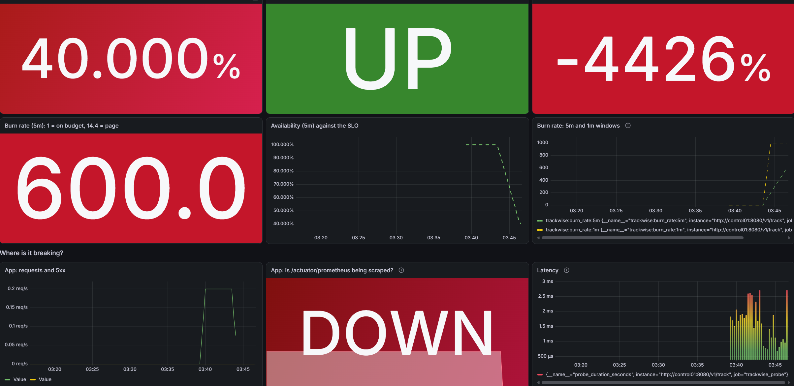

## What's here

- `monitoring/prometheus.yml`: scrape jobs for the app, the probe and node exporters
- `monitoring/blackbox.yml`: the `http_trackwise` probe module
- `monitoring/rules.yml`: recording rules for availability (5m and 6h) and error budget remaining
- `monitoring/dashboard_trackwise.json`: the Grafana dashboard export
- `scripts/exp1.sh`: scripts used to run the expirement outage, collect timestaps and start the service
- `src/main`: java, springboot simple application

## The contract

The service is `GET /v1/track`, the shipment lookup. There are two
commitments, and they are deliberately different.

**SLA, the promise to customers.** 99.5% monthly availability. A request
fails if it gets a 5xx, times out or cannot connect. 4xx responses are
client mistakes and do not count. Excluded: approved tests, other paths, and
announced maintenance up to 4 hours a month. Over 30 days, 99.5% allows 216
minutes of failure.

**SLO, the target I hold myself to.** 99.9% availability over a rolling 30
days, which allows 43.2 minutes. It is tighter than the SLA on purpose. The
gap of about 173 minutes is warning room: if I am spending the SLO budget
too fast, I find out long before the customer promise is at risk.

### How availability is measured

A blackbox probe on infra01 requests `/v1/track` every 5 seconds. A good
probe is an HTTP 2xx within 3 seconds. A 5xx, a timeout or a refused
connection is bad. I use a probe and not the app's own metrics because a dead
app cannot report that it is dead (see "What I found"). Request rate, 5xx
rate and `up` are diagnostics for explaining a problem, not the SLI.

Each probe stands for 5 seconds, so 43.2 minutes is about 518 bad probes out
of 518,400 in 30 days.

The dashboard measures raw availability against the SLO. The SLA's
exclusions are contract terms and are not applied by the monitoring.

### Error budget

    error ratio      = 1 - availability
    budget remaining = 1 - (error ratio / 0.001)
    burn rate        = error ratio / 0.001

A burn rate of 1 spends the budget exactly over the window. A burn rate of 10
spends it ten times too fast.

| Remaining | State | What it means |
|---|---|---|
| over 50% | NORMAL | continue normal work and experiments |
| 25-50% | CAUTION | be careful with risky changes |
| 0-25% | FREEZE | stop feature work, focus on reliability |
| 0% or below | EXHAUSTED | security fixes and recovery only |

A negative value means the budget is overspent. The dashboard shows it that
way and does not clamp it to zero.

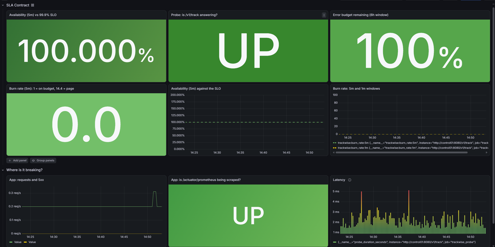

*Healthy state. The stats answer: is it up, are we within the SLO, how much budget is left, how fast are we spending and observing*

### Alerts

- `TrackWiseFastBurn` fires when the 5-minute and 1-minute burn rates are
  both above 14.4 for a minute. That rate spends 2% of a 30-day budget in an
  hour. Needing both windows filters out a single bad probe.
- `TrackWiseProbeMissing` fires when probe data is absent or the probe job is
  down, so a dead exporter cannot hide an outage.

### Lab limits

- The VMs are shut down between sessions. Planned shutdowns are not counted.
  Start control01 first, then infra01. Stop infra01 first, then control01,
  so the probe never runs against an app that is down on purpose.
- The live budget uses a 6-hour window so I can watch it move in one
  session. The contract stays at 30 days.
- Restarts and experiments spend real budget. This is a single instance,
  and that is the point.

## What I found

### Finding 1: My first availability metric hid the outage

I expected that if the app crashed, the dashboard would show almost nothing
and I might not even notice. What actually happened was worse. After I
stopped the service, the availability panel stayed looking healthy for about
7 minutes in Prometheus (8-9 in Grafana) and then the line just disappeared.
It never dropped to zero. The metric was using the app's own request
counters, and once the app was dead it stopped reporting anything at all.
The `up` metric dropped immediately because Prometheus creates that itself.
I wanted a way to track the service even when the service wasn't running, so
I moved the SLI to a blackbox probe.

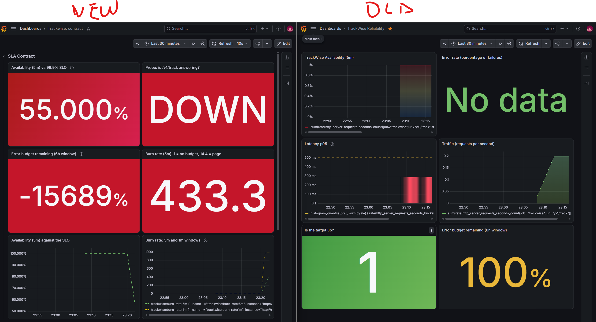
*About 3 minutes after the stop: the old panel looks healthy while the probe says DOWN.*

### Finding 2: The probe noticed in seconds

I expected the probe to tell me much faster when the service was
unavailable. After adding it, `probe_success` dropped to 0 within seconds
when I stopped the service and went back to 1 within seconds of starting it
again. I defined a bad probe as anything that was not a successful HTTP 2xx
response within 3 seconds, including 5xx errors, timeouts, and connection
failures. A customer typo that returns 404 is the customer's fault, but a
valid request that gets no good answer is ours. This felt closer to what a
real user experiences, because it measures whether the service can actually
be reached and used, though only for this one endpoint.

### Finding 3: My monitoring failed before my alerts did

I expected the burn-rate alert to fire when I stopped the service, but
nothing happened for over 6 minutes. After investigating, I found there was
no probe data because the blackbox exporter was not running. Since all of
the burn-rate calculations depended on that data, the alert had nothing to
evaluate. I still don't know why the exporter stopped. The service was
enabled and I chose not to spend more time chasing it. To avoid being blind
So, I added a `TrackWiseProbeMissing` alert to detect when probe
data disappears or the probe scrape fails.

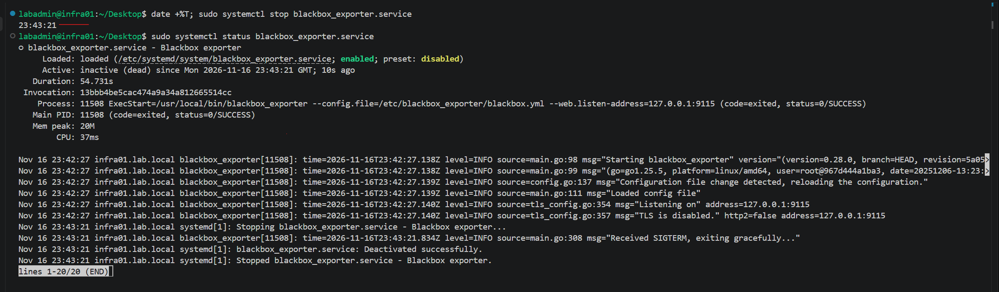

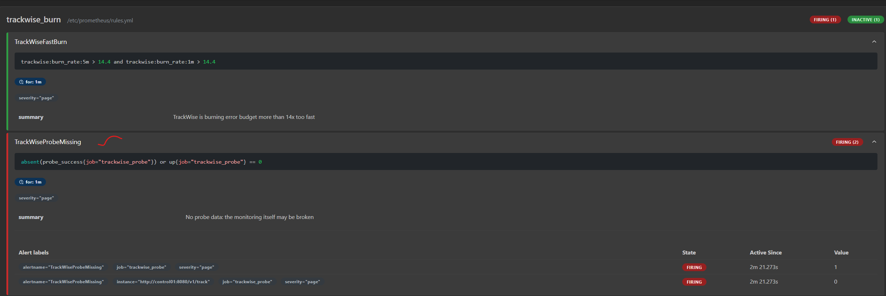

*I added a TrackWiseProbeMissing alert to detect when probe data disappears or the probe scrape fails.*

### Finding 4: A 6-hour budget behaves very differently from a 30-day budget

After my stop tests, the error budget read -129 in Prometheus, which means I
had used about 130 times the budget. By the time I built the Grafana panel
it read -10,672% and only slowly improved as more good probes entered the
window. The bad probes stay inside the window until they age out, so the
budget doesn't recover when the service does. My lab uses a 6-hour window
because the VMs are shut down between sessions. At 5-second probes, that
window allows about 4.3 bad probes, while 30 days allows about 518, so even
a short outage spends a large part of it. When the VMs stayed off for more
than 6 hours, the budget returned to 100% because the old failed probes had
aged out of the calculation. This helped me understand that the same outage
can look very different depending on the size of the observation window

## Experiment 1: TrackWise crashes for 3 minutes

I stopped TrackWise for exactly 180 seconds with a small script that stopped
the service, waited, started it again and logged each timestamp. Before the
run I wrote down what I expected. The baseline was clean: availability
100.000%, probe UP, budget 100%, burn rate 0.0, no firing alerts, and about
0.2 requests a second from the probe.

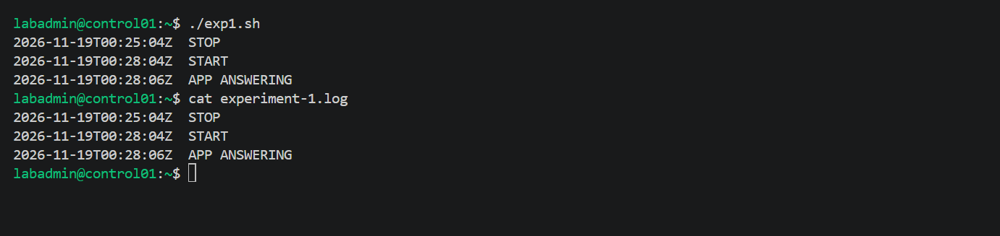
*TrackWise was intentionally stopped for 180 seconds (3 minutes) The outage was generated using a simple script that:*

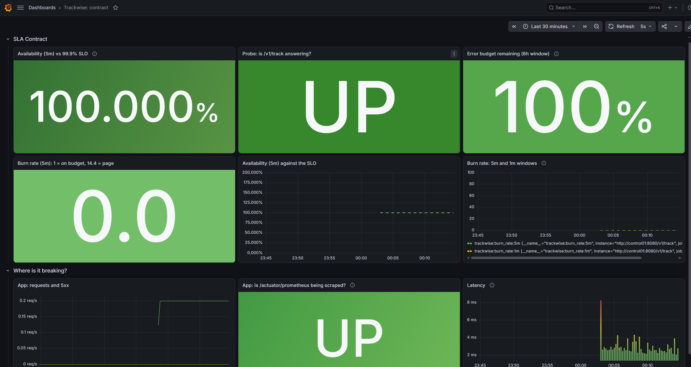
*Healthy state before the stop.*

| Event | Time (UTC) |
|---|---|
| Service stopped | 00:25:04 |
| Alert pending | 00:25:06 |
| Alert firing | 00:26:10 |
| Service started | 00:28:04 |
| Application answering | 00:28:06 |
| Probe back to UP | [read from the probe_success graph] |

| Measure | I predicted | What happened |
|---|---|---|
| Dashboard notices | 5-10 s | within 2 s (the alert was already pending at 00:25:06) |
| Failed probes | ~36 | 37 |
| Alert pending | within seconds | 00:25:06, 2 s after the stop |
| Alert firing | ~2 min | 00:26:10, 66 s after the stop |
| 1-minute burn peak | ~1000 | 1000 |
| 5-minute burn peak | ~600 | 616.7 |
| Recovery detection | within seconds | the app answered 2 s after the start |
| Cost against 30 days | ~7% | ~7% |
| Cost against the 6-hour window | ~830% | about 100 times the budget (-101) |

### During the outage

The probe noticed within seconds. The top row turned red, the metrics scrape
went DOWN and the budget went negative. About 40 seconds in, availability
read 86.667%, which is 8 failed probes out of the last 60.

The app produced no 5xx errors. Its request rate just fell to zero, because
a dead app has nothing to report. This is why the probe is the SLI and not
the app's own metrics.

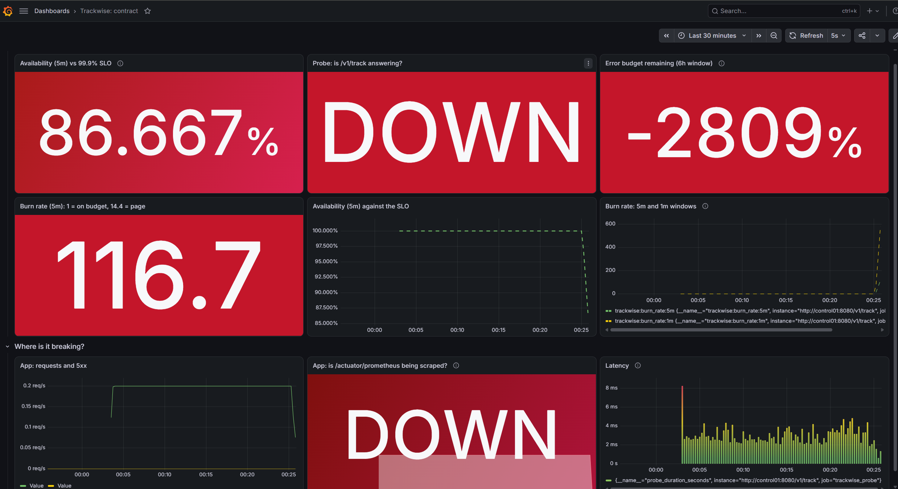
*About 40 seconds into the outage. Availability and burn rate are read a few
seconds apart, so they differ by one probe.*

### The alert

`TrackWiseFastBurn` went pending 2 seconds after the stop and fired at
00:26:10, 66 seconds after the stop. I had predicted about two minutes. It
came sooner because pending started at once, and `for: 1m 20sec` before it fired.
It fires when the 5-minute and 1-minute burn rates are both above 14.4. It
fired during a sustained outage, and I did not test a single bad probe.

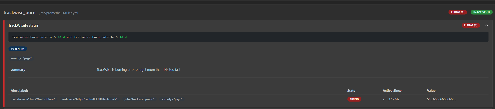
*"Active Since" counts from the pending state, so this was captured shortly
after the restart, at about 00:28:30.*

### Recovery

The app answered 2 seconds after the start, and the probe went UP almost
immediately. The dashboard recovered at different speeds. The 1-minute burn
rate fell to zero about a minute after the last failed probe. The 5-minute
availability climbed back over about five minutes as the failed probes aged
out of its window. The service was healthy again, but the dashboard still
remembered the outage.

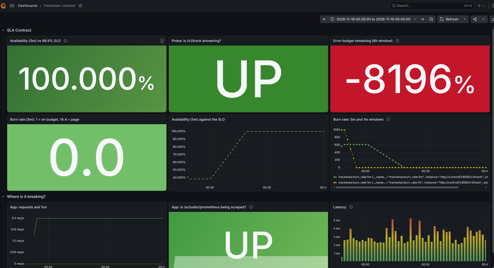
*Probe UP, availability 100%, burn rate 0, and the budget still deep red.*

### What it cost

The outage lasted about three minutes, which worked out to 37 failed probes.

Against the real 30-day SLO, that wasn't as serious as I expected. The SLO allows 43.2 minutes of downtime over a month, so a three‑minute outage consumed roughly 7% of the available error budget.

The lab window told a very different story.

My dashboard uses a 6-hour window so I can observe the budget changing during a single lab session. In a full 6-hour window, only about 4.3 failed probes are allowed before the entire budget is exhausted. During this outage, 37 probes failed, which is more than eight times the whole 6-hour budget.

An interesting thing I learned is that the budget percentage depends on how much data is currently in the window. At the time of the outage, my probe had not yet been running for a full six hours. The window contained only 363 probes, which meant the available budget was much smaller. As a result, the dashboard showed a budget value of around -101x the allowed budget.

As more healthy probes entered the window, the budget slowly became less negative. Nothing about the outage changed, but the failed probes became a smaller proportion of the data being measured.

The main lesson was that the exact same outage can look very different depending on the observation window. Against the real 30-day SLO it was a relatively small reliability event. Against the shorter 6-hour lab window it completely exhausted the available budget many times over.

### What I took from it

- The outage was detected almost immediately. The blackbox probe noticed the service was down within a few seconds, which gave me confidence that the dashboard reflects what a user would actually experience rather than what the application last reported.

- Burn rate told the story much faster than availability. At one point availability was still 86.667%, which doesn't look disastrous at first glance. But the burn rate was already around 117, far above the 14.4 alert threshold. This showed me why SRE teams use burn rate alerts: they highlight reliability problems before availability numbers look obviously bad.

- Fixing the service does not fix the budget. After restarting TrackWise, the probe immediately returned to UP and the burn rate eventually dropped back to zero. The error budget stayed negative because the outage was still part of the measurement window. The service had recovered, but the reliability cost of the outage remained.

- The size of the observation window changes everything. The same three‑minute outage had very different meanings depending on which budget I looked at. Against the real 30‑day SLO it consumed only about 7% of the available budget. Against the lab's 6‑hour window it exhausted the budget many times over. This helped me understand why SREs pay close attention to the time window behind every reliability metric.

## Monitoring the Monitoring
One failure mode I wanted to test was what happens if the monitoring system itself breaks.

Earlier in the project I discovered that when the blackbox exporter was unavailable, the burn-rate calculations stopped receiving probe_success data. Without a probe there is no signal to measure, which means outage alerts can stop working at exactly the moment they are needed.

To test this, I stopped the exporter and waited for the TrackWiseProbeMissing alert to evaluate.

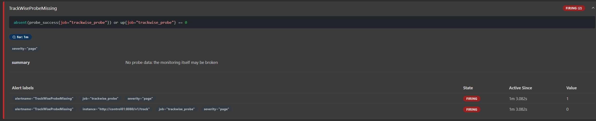
*The alert fired after one minute, as configured by the rule:*

### What I learned
A green dashboard is only useful if I can trust the monitoring behind it.
Losing a service and losing the probe are different failures that need different alerts.
Monitoring should monitor itself. Without `TrackWiseProbeMissing`, a failed exporter could hide a real outage by preventing burn-rate alerts from evaluating.

### What's missing

**Alertmanager.** Alerts fire in Prometheus and are visible in its UI, but nothing sends a notification. In this lab, someone has to be looking to see that an alert fired. Routing alerts to email or Slack is the next project.
